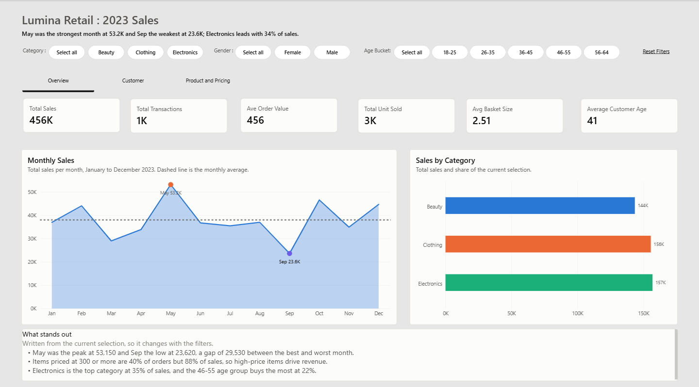
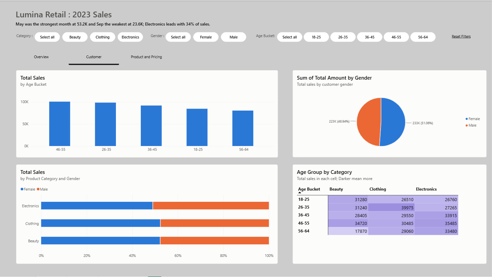

# Retail Sales Dashboard (Power BI)

An interactive Power BI dashboard analyzing 2023 retail sales. It covers monthly trends, category and gender breakdowns, an age group heatmap, and pricing analysis, with synced filters across three pages.

## Preview

## Key findings

- Total sales for 2023 came to about 456K, with an average order value of about 456.
- May was the strongest month (53.2K) and September the weakest (23.6K).
- Electronics (157K), Clothing (156K), and Beauty (144K) are close, so no single category dominates.
- Sales split almost evenly by gender: Female 233K (51%) and Male 223K (49%).
- Order size matters: sales grow steadily from 1-unit to 4-unit orders.
- Higher price points (300 and 500) bring in most of the revenue.

## Pages

| Page | What it shows |
|---|---|
| Overview | KPI cards with a 30-day trend, monthly sales with peak and least month, sales by category, and a subtitle that updates with the filters |
| Customer | Sales by age group, sales by gender, category by gender, and an age group by category heatmap |
| Product and Pricing | Units sold and average order value by category, sales by price per unit, and sales by basket size |

## Features

- Category, Gender, and Age group slicers, synced across all pages, with a Reset filters button
- Peak and least month markers on the monthly sales chart that follow the selected filters
- KPI cards with a 30-day trend arrow (green up, red down)
- Subtitle text that rewrites itself based on the current selection
- Page navigator with consistent layout across pages

## Data

Source file: `data/retail_sales_dataset.csv`

| Column | Description |
|---|---|
| Date | Transaction date (2023) |
| Customer ID | Unique customer identifier |
| Gender | Female or Male |
| Age | Customer age |
| Product Category | Beauty, Clothing, or Electronics |
| Quantity | Units in the order |
| Price per Unit | Unit price |
| Total Amount | Order total |

Calculated columns added in the model: `Month Name`, `Month Num`, `Age Group`, `Age Group Sort`, `Basket Size`.

## Key DAX measures

| Measure | Purpose |
|---|---|
| `Total Sales` | Sum of `Total Amount` |
| `Total Unit Sold` | Sum of `Quantity` |
| `Ave Order Value` | Average sales per order |
| `Avg Basket Size` | Units per order |
| `Max Month` / `Min Month` | Highest and lowest monthly sales for the current filters |
| `Peak Point` / `Least Point` | Return a value only for the peak or least month, used for chart markers |
| `Peak Label` / `Least Label` | Text labels such as "May 53.2K" |
| `Anchor Date` | Latest date in the data |
| `Last 30 Days Sales` / `Prev 30 Days Sales` | Windows used for the trend |
| `Trend Text` / `Trend Color` | Arrow text and color for the KPI card |
| `Subtitle` | Dynamic summary sentence |

## What I learned

- Date hierarchies caused the peak and least measures to return a value for every month. Creating my own `Month Name` column and sorting it with `Month Num` fixed it.
- Using a measure directly inside a `CALCULATE` date filter fails, so the date bounds are stored in `VAR`s first.
- Removing filters on only the month and date columns (instead of the whole table) keeps the slicers working with the peak and least logic.
- Formatting set manually on a visual overrides the theme, so visuals need to be reset to default to pick up theme changes.

## How to open

1. Install [Power BI Desktop](https://powerbi.microsoft.com/desktop/) (Windows).
2. Open `retail-sales-dashboard.pbix`.
3. If the data does not load, update the source path: Home > Transform data > Data source settings.

## Tools

Power BI Desktop, DAX, Power Query

## Author

CK